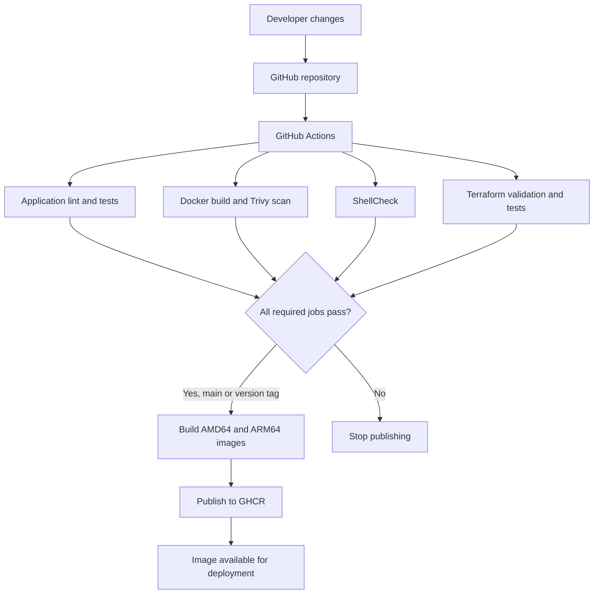
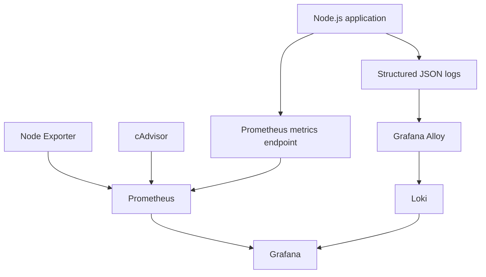

# DevOps Engineering Assessment

A containerized Node.js application with automated CI, multi-architecture Docker publishing, infrastructure-as-code, Kubernetes deployment, and an observability stack.

**Repository:** https://github.com/mdshofiullah/devops-assessment

## 1. Project Overview

This project demonstrates a DevOps workflow covering:

- Node.js application development and automated tests.
- Multi-stage Docker image builds and container security.
- GitHub Actions CI and GitHub Container Registry (GHCR) publishing.
- AWS infrastructure definitions using Terraform.
- Kubernetes deployment, health probes, resource limits, and autoscaling.
- Prometheus metrics, Grafana dashboards, Loki log aggregation, and Grafana Alloy.
- A Bash system health-monitoring utility.

### Implementation status

| Area | Status |
|---|---|
| Node.js application and tests | Implemented and locally tested |
| Docker image build | Implemented and tested |
| GitHub Actions CI | Implemented; successful runs available in GitHub Actions |
| Multi-architecture GHCR publishing | Implemented |
| Terraform | Validated and mock-tested; not applied to AWS |
| Kubernetes | Tested locally using kind |
| Prometheus and Grafana | Running locally |
| Loki and Alloy | Configured for log collection |
| Bash health-monitoring script | Implemented and validated |
| AWS EC2 deployment | Not performed |
| AWS deployment automation and rollback | Not implemented or verified end to end |

This distinction is intentional: local validation and Terraform mock tests are not evidence of live AWS infrastructure deployment.

## 2. Architecture

### Application and CI/CD



The current pipeline ends at GHCR publishing. It does not automatically deploy to an AWS EC2 instance.

### Kubernetes

```mermaid
flowchart TD
    A[Container image] --> B[kind Kubernetes cluster]
    B --> C[devops namespace]
    C --> D[Deployment]
    D --> E[Application pods]
    E --> F[ClusterIP Service]
    E --> G[Readiness and liveness probes]
    H[Horizontal Pod Autoscaler] --> D
    I[Metrics Server] --> H
    J[ConfigMap and runtime Secret] --> D
```



### Observability



## 3. Technology Stack

| Component | Technology |
|---|---|
| Runtime | Node.js 24 |
| Application framework | Express 5 |
| Metrics | Prometheus client |
| Logging | Pino and pino-http |
| Testing | Jest and Supertest |
| Code linting | ESLint |
| Containerization | Docker |
| Container security | Trivy and Hadolint |
| CI/CD | GitHub Actions |
| Image registry | GitHub Container Registry |
| Infrastructure as code | Terraform |
| Container orchestration | Kubernetes |
| Local Kubernetes | kind |
| Metrics and alerting | Prometheus |
| Dashboards | Grafana |
| Log aggregation | Loki |
| Log collection | Grafana Alloy |
| Host metrics | Node Exporter |
| Container metrics | cAdvisor |

## 4. Repository Structure

```text
.
├── .github/
│   └── workflows/
│       └── ci.yml
├── k8s/
│   ├── namespace.yaml
│   ├── configmap.yaml
│   ├── deployment.yaml
│   ├── service.yaml
│   └── hpa.yaml
├── monitoring/
│   ├── .env.example
│   ├── docker-compose.yml
│   ├── alloy/
│   │   └── config.alloy
│   ├── grafana/
│   │   ├── dashboards/
│   │   └── provisioning/
│   ├── loki/
│   │   └── config.yml
│   └── prometheus/
│       ├── prometheus.yml
│       └── alerts.yml
├── scripts/
│   └── system_health.sh
├── src/
├── tests/
├── terraform/
│   ├── environments/
│   ├── tests/
│   ├── backend.s3.hcl.example
│   ├── compute.tf
│   ├── ecr.tf
│   ├── iam.tf
│   ├── monitoring.tf
│   ├── outputs.tf
│   ├── provider.tf
│   ├── security.tf
│   ├── variables.tf
│   ├── versions.tf
│   └── user_data.sh.tftpl
├── Dockerfile
├── docker-compose.yml
├── package.json
└── README.md
```

## 5. Prerequisites

For local development:

- Node.js 24 and npm.
- Docker Engine and Docker Compose v2.
- Git.

For Kubernetes validation:

- kubectl.
- kind.
- A Kubernetes metrics server for HPA metrics.

For infrastructure validation:

- Terraform 1.17.1 (the version used in the CI workflow).

For live AWS deployment, an AWS account, credentials, a configured region, and a bootstrapped remote-state backend are also required.

## 6. Run the Application Locally

Install dependencies:

```bash
npm ci
```

Run linting:

```bash
npm run lint
```

Run tests:

```bash
npm test
```

Run tests with coverage:

```bash
npm run test:coverage
```

Start the application:

```bash
npm start
```

The application exposes the following endpoints:

| Endpoint | Purpose |
|---|---|
| `/` | Application response |
| `/health` | Health check |
| `/metrics` | Prometheus metrics |

Example checks:

```bash
curl http://localhost:8080/
curl http://localhost:8080/health
curl http://localhost:8080/metrics
```

## 7. Docker

Validate the root Compose configuration:

```bash
docker compose config --quiet
```

Build and start the application:

```bash
docker compose up --build -d
```

Check container status:

```bash
docker compose ps
```

Inspect logs:

```bash
docker compose logs -f
```

Check application health:

```bash
curl http://localhost:8080/health
```

Stop the application:

```bash
docker compose down
```

The Docker image uses a multi-stage build and a non-root runtime user. The container also has a health check and restrictive runtime settings.

## 8. GitHub Actions CI/CD

Workflow file:

```text
.github/workflows/ci.yml
```

The workflow runs on:

- Pushes to `main`.
- Pushes of version tags matching `v*`.
- Pull requests targeting `main`.

### Validation jobs

| Job | Checks |
|---|---|
| `test` | npm dependency installation, production dependency audit, ESLint, Jest and coverage |
| `docker` | Hadolint, root Docker Compose configuration, Docker build, Trivy CRITICAL vulnerability scan |
| `shellcheck` | Shell script static analysis |
| `terraform` | Terraform formatting, initialization, validation, and mock-provider tests |

### Image publishing

The `publish` job requires all four validation jobs to succeed.

It builds and publishes:

- `linux/amd64`
- `linux/arm64`

Images are published to:

```text
ghcr.io/mdshofiullah/devops-assessment
```

The workflow generates SHA-based image tags, a `latest` tag on the default branch, and semantic-version tags for version releases.

The publishing job uses GitHub Actions' `GITHUB_TOKEN` with package write permissions.

**Deployment limitation:** The workflow currently publishes the image to GHCR. An automated GHCR-to-AWS deployment, EC2 smoke test, and rollback workflow have not been implemented or verified.

## 9. Terraform Infrastructure

Terraform configuration is located in:

```text
terraform/
```

The configuration includes definitions for:

- ECR repository.
- Security groups.
- IAM role and instance profile.
- CloudWatch log group and monitoring permissions.
- Optional EC2 compute configuration.
- Instance bootstrap configuration.

The EC2 deployment is optional and disabled by default in the configuration.

### Local validation

From the repository root:

```bash
cd terraform

terraform fmt -check -recursive
terraform init -backend=false -input=false
terraform validate
terraform test

cd ..
```

The Terraform tests use a mocked AWS provider. They validate infrastructure configuration without creating AWS resources.

### Remote state

The repository contains:

```text
terraform/backend.s3.hcl.example
```

The S3 backend must be configured with a real, pre-existing state bucket before using remote state. Do not commit state files, AWS credentials, or populated private variable files.

Example environment variable files are provided under:

```text
terraform/environments/
```

### AWS deployment status

No live Terraform apply has been performed. No EC2 instance, S3 state bucket, ECR repository, IAM role, or CloudWatch resource has been verified in a real AWS account.

The AWS infrastructure should be treated as authored and mock-tested, not deployed.

A complete live deployment also requires verifying the image delivery path from GHCR to ECR, or changing the EC2 bootstrap process to pull from the selected registry.

## 10. Kubernetes

Kubernetes manifests are stored in:

```text
k8s/
```

Resources include:

- Namespace.
- ConfigMap.
- Deployment.
- ClusterIP Service.
- Horizontal Pod Autoscaler.

The deployment is configured with multiple replicas, rolling updates, health probes, resource requests and limits, and restrictive container security settings.

### Apply manifests

Build the local image:

```bash
docker build -t devops-assessment:1.0.0 .
```

For a kind cluster named `devops`, load the image:

```bash
kind load docker-image devops-assessment:1.0.0 --name devops
```

Apply the manifests:

```bash
kubectl apply -f k8s/namespace.yaml
kubectl apply -f k8s/configmap.yaml
# Create the runtime Secret if it does not already exist
if ! kubectl get secret app-secrets -n devops >/dev/null 2>&1; then
  kubectl create secret generic app-secrets \
    --namespace devops \
    --from-literal=APP_TOKEN="$(openssl rand -hex 32)"
fi
kubectl apply -f k8s/deployment.yaml
kubectl apply -f k8s/service.yaml
kubectl apply -f k8s/hpa.yaml
```

Inspect resources:

```bash
kubectl get pods -n devops
kubectl get services -n devops
kubectl get deployments -n devops
kubectl get hpa -n devops
```

Check rollout status:

```bash
kubectl rollout status deployment/devops-assessment -n devops
```

Inspect HPA metrics:

```bash
kubectl describe hpa -n devops
kubectl top pods -n devops
```

The HPA requires a functioning Kubernetes metrics API. The local kind test environment used Metrics Server; its kubelet TLS workaround is for local testing only and should not be copied into a production cluster without security review.

### Access the application

Inspect the Service name:

```bash
kubectl get services -n devops
```

Forward the Service port to a local port. For a Service named `devops-assessment`:

```bash
kubectl port-forward service/devops-assessment 28082:80 -n devops
```

In another terminal:

```bash
curl http://localhost:28082/health
```

### Rollback

Inspect rollout history:

```bash
kubectl rollout history deployment/devops-assessment -n devops
```

Undo the latest rollout:

```bash
kubectl rollout undo deployment/devops-assessment -n devops
```

Verify the result:

```bash
kubectl rollout status deployment/devops-assessment -n devops
kubectl describe deployment/devops-assessment -n devops
```

The tested kind deployment used a locally loaded image. It is separate from a production deployment to AWS.

## 11. Monitoring and Observability

The monitoring stack is defined in:

```text
monitoring/docker-compose.yml
```

It includes:

| Service | Purpose |
|---|---|
| Application | Exposes application metrics and structured logs |
| Prometheus | Scrapes metrics and evaluates alert rules |
| Grafana | Dashboards and data exploration |
| Loki | Log storage and querying |
| Grafana Alloy | Docker log discovery, processing, and forwarding |
| Node Exporter | Host metrics |
| cAdvisor | Container metrics |

### Start the monitoring stack

Build the image expected by the monitoring Compose configuration:

```bash
docker build -t devops-assessment:1.0.0 .
```

Create the local environment file:

```bash
cp monitoring/.env.example monitoring/.env
```

Edit `monitoring/.env` and set local Grafana credentials. Do not commit this file or use a test password in a public deployment.

Start the stack:

```bash
docker compose \
  --env-file monitoring/.env \
  -f monitoring/docker-compose.yml \
  up -d
```

Check service status:

```bash
docker compose \
  --env-file monitoring/.env \
  -f monitoring/docker-compose.yml \
  ps
```

Check Grafana:

```bash
curl http://localhost:3000/api/health
```

Grafana is exposed on port `3000`. Keep the Codespaces port private and do not expose this test monitoring stack directly to the public internet.

### Dashboards

Grafana dashboards are provisioned from JSON files:

```text
monitoring/grafana/dashboards/
```

The dashboards cover:

1. Application metrics: request rate, errors, and latency percentiles.
2. Host metrics: CPU, memory, disk, and network.
3. Container metrics: CPU and memory consumption, including memory usage relative to reported cgroup limits.

The host dashboard describes the Linux environment visible to the monitoring containers. In GitHub Codespaces, this is not a dashboard of the user's physical Windows machine.

### Metrics collection

Prometheus configuration:

```text
monitoring/prometheus/prometheus.yml
```

Prometheus scrapes the application, itself, Node Exporter, and cAdvisor.

Alert rules are defined in:

```text
monitoring/prometheus/alerts.yml
```

The configured alerts cover application availability, application error rate, application latency, host CPU, and available host memory.

### Log collection

Application logs are structured JSON logs.

Grafana Alloy discovers Docker containers, reads their logs, processes JSON fields, and forwards log entries to Loki.

Loki configuration:

```text
monitoring/loki/config.yml
```

The configured log retention period is seven days.

Use Grafana Explore with the Loki data source to query application logs. Generate a new application request when verifying log ingestion.

### Monitoring security notes

The local Compose monitoring setup uses privileged host/container access for cAdvisor and mounts the Docker socket for Alloy log collection. Access to the Docker socket can provide powerful control over the Docker host.

These settings are for this local assessment environment. They require a security review before use on shared or production infrastructure.

## 12. Bash System Health Monitor

Script:

```text
scripts/system_health.sh
```

The utility reports:

- CPU utilization.
- Memory utilization.
- Usage for mounted filesystems.
- System load averages.
- The five processes consuming the most memory.

It appends timestamped results to:

```text
health_log.txt
```

The log is rotated at approximately 1 MB, retaining three backups.

### Usage

Human-readable report:

```bash
./scripts/system_health.sh
```

JSON report:

```bash
./scripts/system_health.sh --json
```

Custom warning thresholds:

```bash
./scripts/system_health.sh --disk 80 --cpu 90 --mem 85
```

Help:

```bash
./scripts/system_health.sh --help
```

### Exit codes

| Code | Meaning |
|---:|---|
| 0 | Healthy |
| 1 | Warning |
| 2 | Critical or invalid configuration |

The default warning thresholds are 80% disk, 90% CPU, and 85% memory. Critical thresholds default to 10 percentage points above disk and memory warning thresholds and 5 points above the CPU warning threshold, capped at 100%.

### Validation

```bash
bash -n scripts/system_health.sh
shellcheck scripts/system_health.sh
./scripts/system_health.sh --json | python -m json.tool
```

### Optional five-minute cron schedule

To run the script every five minutes, open the user's crontab:

```bash
crontab -e
```

Add a line using the absolute path to the script:

```cron
*/5 * * * * /absolute/path/to/devops-assessment/scripts/system_health.sh >/dev/null 2>&1
```

The script writes its reports to `health_log.txt`. The schedule should be installed on the machine where monitoring is intended; a Codespaces cron job is not a persistent production monitoring service.

## 13. Security and Design Decisions

The implementation applies several security controls:

- The application container runs as a non-root user.
- The Docker build uses a multi-stage process.
- Container health checks are configured.
- Kubernetes containers use non-root execution and restrictive security settings.
- Kubernetes containers use read-only root filesystems and drop Linux capabilities.
- Kubernetes health probes and resource requests/limits are configured.
- The EC2 configuration uses an instance role rather than requiring static AWS credentials on the instance.
- Terraform security group rules are configurable.
- The Terraform instance configuration enables IMDSv2.
- GitHub Actions uses scoped permissions for package publishing.
- Trivy blocks images with CRITICAL findings.
- Local environment files and generated health logs are excluded from source control.

The monitoring stack's Docker socket and privileged cAdvisor access remain important exceptions that require hardening for production use.

## 14. AWS Cost Estimation

No AWS resources were deployed for this assessment, so no live AWS charges were incurred.

A reliable monthly estimate must be calculated using the final AWS region and infrastructure values. The estimate should account for:

| Cost component | Pricing input |
|---|---|
| EC2 | Instance type, region, and running hours |
| EBS | Root volume size and storage type |
| S3 | Terraform state storage and request volume |
| CloudWatch Logs | Monthly ingestion, retention, and queries |
| Data transfer | Expected inbound and outbound traffic |
| ECR | Image storage and transfer |

Use the AWS Pricing Calculator:

https://calculator.aws/

Record the selected region, instance type, storage sizes, log ingestion assumptions, and estimated monthly total before treating the estimate as final. Actual costs vary by region, usage, and current AWS pricing.

## 15. Limitations and Future Improvements

The following work remains for a production-ready implementation:

1. Provision and verify the AWS remote-state bucket.
2. Run Terraform plan and apply in a real AWS account.
3. Verify EC2 bootstrap, ECR image availability, IAM permissions, and CloudWatch log delivery.
4. Implement automated deployment from GHCR to ECR or another approved registry path.
5. Add an EC2 deployment stage using SSM or another secure deployment mechanism.
6. Implement deployment smoke tests and automated rollback.
7. Add Kubernetes manifest and monitoring configuration validation to CI.
8. Harden monitoring permissions and secrets management.
9. Complete an AWS Pricing Calculator estimate using the final infrastructure assumptions.
10. Add production alert notification destinations and operational runbooks.

## 16. AI Assistance Disclosure

Generative AI assistance was used during implementation and troubleshooting, including application and infrastructure guidance, configuration review, shell-script development, debugging, and documentation.

Commands and configurations were tested in the local development environment where indicated. AWS infrastructure was not deployed or live-tested. The final implementation should be reviewed by the assessment author before production use.
